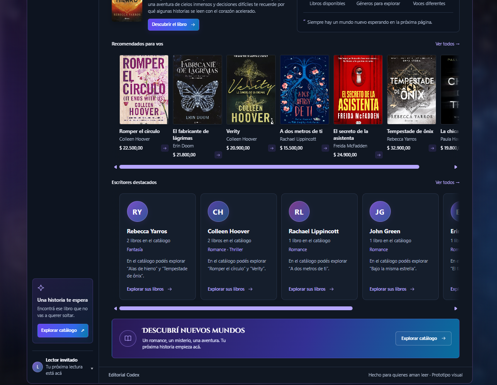

# Referencia visual: prototipo propio de Editorial Codex

La referencia visual del equipo es el prototipo propio de Editorial Codex, publicado en el repositorio [Prototipos-Frontend en GitHub](https://github.com/ALucrecia-Pagano/Prototipos-Frontend).

También se puede ver el [prototipo publicado en línea](https://alucrecia-pagano.github.io/Prototipos-Frontend/).

## Capturas

## Créditos

Las portadas de libros que se ven en las capturas pertenecen a sus autores, editoriales e ilustradores y se usan solo como ejemplo visual en un trabajo educativo, sin fines comerciales.

El prototipo tomó a BookNest como inspiración inicial. El proyecto sigue usando tapas generadas con CSS, sin imágenes de portadas (DD-12 y DD-15 en [`knowledge-base/09_decisiones_y_supuestos.md`](../../knowledge-base/09_decisiones_y_supuestos.md)). Las capturas no habilitan imágenes de portadas en la página.

El prototipo citado en DD-14 (`../../prueba_parcial_prog3`) es el mismo que está publicado en el repositorio Prototipos-Frontend; se subió sin la imagen de BookNest y sin la carpeta `.vscode`.
